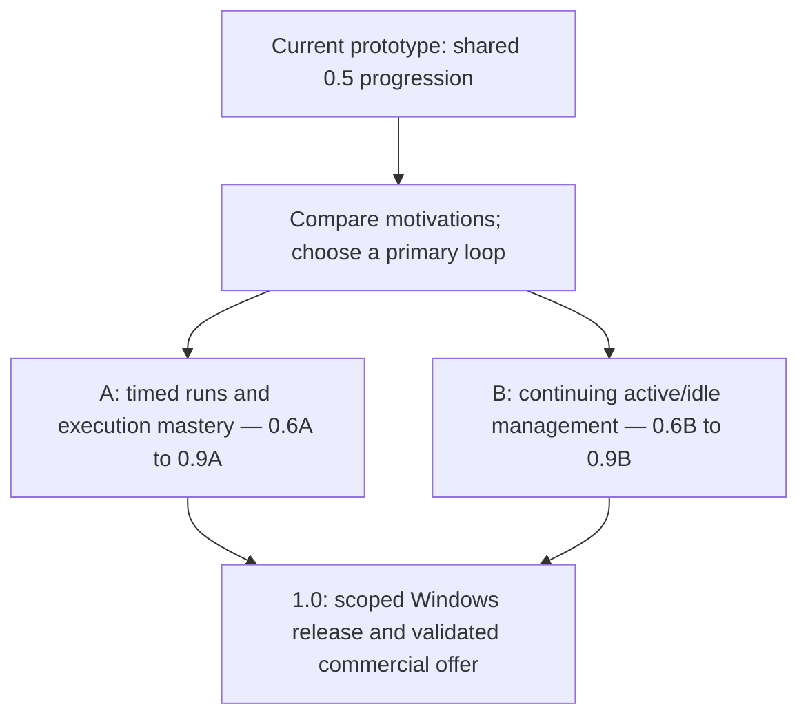

# Incremental strategy game — Branching pre-1.0 roadmap

**Status:** Initial 0.1–0.4 experiments accepted in their revised form; 0.5 progression prototype is playable. Next planning gate: choose a primary speedrun or active/idle management direction.

**Last planning update:** October 29, 2026.
**Document type:** Prototype evidence and provisional branching roadmap. Future milestones describe proposed work, not implemented features.

## 1. Shared foundation and open product direction

- **Shared gameplay ingredients:** A deterministic economy with production bottlenecks, allocation, upgrade sequencing and manual timing. The primary appeal is still open: optimizing repeatable timed runs, or developing an economy through active and idle periods.
- **Active play:** The prototype integrates timing as an alternate production mode. Its role differs by branch: execution mastery can be central to speedrunning; timing remains an optional complement to passive progress in management play. No artificial session attempt scarcity while validating either loop.
- **Progression:** The original plan favored persistent growth without prestige. That remains the management candidate. The speedrun candidate needs isolated, repeatable run state; restarting a run must be distinguished from resetting a persistent account. Run XP, account XP and any carryover rules are design decisions before branch implementation.
- **Target:** Windows-first Unity 6/C# game, potentially released on Steam; preserve a path toward macOS, iOS, and Android.
- **Architecture/authority:** Keep deterministic C# simulation separate from Unity, portable to a server and free of unnecessary dependencies. Eventual account progression, elapsed time and rewards must be authoritative, with durable cross-platform identity. Which branch wins changes the first end-to-end proof; it does not make the present local prototype trusted or persistent.
- **Business direction:** Either branch may eventually monetize. Premium access, paid content, cosmetics and suitable convenience features are hypotheses, not a chosen model or evidence of demand. Evaluate them against the selected loop before implementation; monetization work still requires explicit approval.
- **Presentation/identity:** A theme, customizable economic environments, a humanoid avatar and a separate tactical scene remain candidates. Neither branch requires an avatar or separate scene merely to satisfy an inherited milestone.
- **Theme:** Uncommitted. Mining labels such as “Ore” and “Alloy” are placeholders; economic IDs and game rules should not depend on a mining setting.

## 2. Prototype 0.1 — baseline and design history

### Original, mathematically tested simulation

- Three processes in series: produce A, convert A into B, use B for Development.
- Initially **6 allocatable capacity units**; nonnegative integer allocations; reallocations are free. Unassigned capacity allowed.
- Three repeatable efficiency upgrades. Costs increase geometrically; effects increase linearly.
- At upgrade levels `L1, L2, L3`, each assigned unit has these **maximum** rates per second:
  - Process 1 (A production): **2 + L1 units A produced**.
  - Process 2 (A→B): **2 A consumed**, producing **1 + 0.5 × L2 B**.
  - Process 3 (Development): **1 B consumed**, producing **1 + 0.5 × L3 development output**.
- If input is insufficient, throughput is limited and resource balances never become negative. A fixed 0.1-second reference tick evaluates stages in order, allowing same-tick output to feed downstream stages. Exact fixed-point integer subunits are preferred in code.
- Observed initial allocation patterns: **3/2/1** can build inventory while progressing; **2/2/2** can use A and B as fast as they are produced; after efficiency upgrades, **2/3/1** and **2/2/2** may become more favorable. These are examples, not proof of optimal strategies.

### Implemented 0.1 economy

Repository inspection and fresh Unity test runs confirmed these mechanics on October 29, 2026:

- Distinguish **Credits** (spendable primary currency) from **Lifetime XP** (cumulative achievement, never spent).
- Development generates **equal quantities of Credits and Lifetime XP**, using the existing output formula. Earlier `Progress` terminology should be updated where applicable.
- Both efficiency upgrades **and** capacity expansions cost Credits; A and B remain production-flow inputs rather than upgrade currencies.
- **Experimental efficiency costs:** first level 20 / 40 / 60 Credits for Processes 1 / 2 / 3, doubling for each subsequent level.
- **Experimental capacity growth:** start at 6; buy +1 unit, capped at 10 for the experiment; suggested Credit prices 120, 300, 750, 1,875.
- These prices are **test parameters, not accepted long-term balance**. Do not confuse test projections from older A/B-priced upgrades with the revised Credits-only economy.
- Stable, theme-independent resource/process/upgrade IDs; player-facing names reside in presentation data.
- Validated simulation actions are methods that safely reject unaffordable or invalid purchases and capacity assignments. They are a gameplay architecture feature; unit tests and Unity playtesting verify their behavior.

### What the first human playtest found

- The economic math was initially hard to interpret: some resource counters stayed flat because production matched consumption, not because a process was inactive.
- UI felt too text-heavy; upgrade costs and buttons were not immediately intuitive.
- Reduce mouse travel: position `− [allocation] +` together and keep upgrade buttons on the same side of process rows.
- Use **consistent resource-specific colors** in balances, rates and costs, reinforced by labels (color should not be the only distinction).
- Show **net rates**, clearly distinguish zero-net flow from blocked production, and use short explanations of bottlenecks such as “Need more A.” Preserve deeper formulas as optional detail rather than permanent clutter.
- Upgrade choices changed effective allocation strategies in encouraging ways. **Long-term playability remains unproven**, and a minute of play was not enough to measure sustained engagement.

### 0.1 exit/handoff checklist — complete

- [x] Confirm which of the latest Credits/XP and capacity features were actually implemented.
- [x] Check Unity Play Mode loads, production continues, and allocation / purchase controls work.
- [x] Run tests for deterministic production, purchases, capacity constraints and invalid actions.
- [x] Confirm readability of costs, net production and bottlenecks.
- [x] Save working project state and commit/push to GitHub when ready.

Completion evidence: fresh runs passed 25/25 EditMode and 4/4 PlayMode tests;
Unity reported no compilation failure or Console errors, with Prototype01 active.
The user confirmed the checklist was complete, including human readability and
the prior save/commit/push handoff. Commit/push was not repeated in this session.
Unity logged a warning about the previously repaired Visual Studio package cache
file; package operations may replace that local repair. Long-term balance and
engagement remain questions for subsequent experiments.

## 3. Shared progress, direction gate and branch milestones

### 0.2 — Economic depth experiment — complete

**Implementation update (October 29):** The user has manually explored 0.1
investment strategies. Standard/Fast Conversion is now selectable behind an
Inspector experiment toggle; Standard is the starting mode. Fast uses twice the A
for 50% more B per converter, with the existing upgrade multiplier. See
[Prototype02.md](Prototype02.md) for rules and comparison instructions. The
user's five-minute playtest found both modes useful and the strategies more
complex, dynamic and flexible. This satisfies the initial experiment; long-term
mode balance remains open. With divisible allocations, Fast gains a sustainable
efficiency advantage as A production is upgraded; integer allocation and inventory
buffers can still favor Standard situationally.

**Question:** Can players discover multiple viable strategies, or does the economy settle into repetitive arithmetic?

- Playtest Credits-only efficiency vs. capacity reinvestment using identical starting conditions.
- Run short, repeatable tests (e.g. 5/10/15 minutes); compare lifetime XP, capacity purchased, upgrade mix, time-to-milestone and frequency of meaningful reallocation.
- Introduce **one** selectable alternate process mode in **one** slot (e.g. steady vs. burst Development, or efficient vs. fast Conversion) behind a test toggle. Avoid building a large combinatorial tech tree.
- Preserve a baseline scenario to tell whether the change improves decisions or merely increases output.
- **Exit criterion:** At least two materially different approaches feel worth trying and have observable trade-offs; UI remains understandable.

### 0.3 — Skill production experiment

**Scope revised October 29:** At the user's request, first test a timing game as
an alternate resource-production mode within the economy. A separate tactical
scene and humanoid/avatar are deferred. This revision intentionally brings a
small, validated production reward forward from 0.4.

**Question:** Is a short timing challenge responsive, understandable and enjoyable
as an optional alternative to passive production?

- Add Passive/Timing selection to the Resource A Production slot. Passive remains the default.
- Click a bar when its marker enters a labeled success zone, with a smaller critical zone inside. Success gives 1x reward, critical 1.5x, and outside gives zero. Show graded feedback and hit/attempt counts.
- Timing replaces passive A output. Validated hits produce A using assigned Production capacity and efficiency; other processes continue.
- Repeatable without diminishing rewards or a session attempt limit. One click per sweep is part of the timing challenge.
- Preserve a toggle to disable the experiment; keep simulation and reward rules independent of Unity.
- No art pipeline, customization, inventory, premium currency, or elaborate level design.
- **Exit criterion:** Inputs are responsive; players understand success/failure; repeated attempts reveal skill improvement.

Implementation and playtest instructions: [Prototype03.md](Prototype03.md).
**Initial playtest accepted (October 29):** The user approved the current
prototype for commit. Active play competes for attention with idle management,
encouraging mode switching, and makes upgrade decisions more interesting.
Long-term reward balance and repeated-attempt skill improvement remain open.
Future ideas, deferred for now: a combo tracker for consecutive successes and/or
criticals, with stacking bonus factors. These are not implemented.

### 0.4 — Combined active/idle loop

**Covered by the revised 0.3 prototype (user accepted October 29):** Timing
production awards simulation-validated A and runs alongside the economy. Initial
playtesting found that attention shifts between active timing and idle management,
and that this makes upgrades more interesting. The user considers this sufficient
to move to 0.5. Formal policy comparisons, revisit metrics, long-term balance and
server-trusted elapsed time remain unverified or deferred; they are not claimed
complete. The bullets below preserve the original milestone's intent.

**Question:** Does optional tactical play complement the economy instead of becoming a compulsory chore?

- Award bounded, validated economic rewards for tactical success (e.g. Credits or a temporary economic benefit). Decide rewards through simulation commands, not direct UI state mutation.
- Compare progress from economy-only play, tactical-heavy play, and mixed play. Aim for different but viable patterns.
- Add basic session metrics and revisit intervals; simulate elapsed-time accumulation only through explicit simulation inputs. Do not trust the user's wall clock.
- **Exit criterion:** Switching between optimization, tactical play and downtime feels rewarding; tactical success is not mandatory.

### 0.5 — Progression and breadth test

**Current slice:** Gate Fast Conversion at 100 lifetime XP and Timing Production
at 500 lifetime XP. XP is never spent; unlocks enable optional selection without
automatically changing modes. Hide locked controls until earned; keep one short
next-unlock cue as a near-term objective. Detailed rates and recipes are optional
through the Details control. These thresholds are experimental. See
[Prototype05.md](Prototype05.md). Longer-term goals beyond the initial unlocks
remain future work; this slice alone does not complete the milestone.

**Latest playtest notes (October 29):** The compact UI worked well during the
user's longest playtest so far (duration not recorded). Future progression ideas:
custom success/critical multipliers, upgrades to Fast Conversion's ratio, and more
manual timing triggers using keys or separate clickable skill windows.

**Candidate audience direction:** Explore speedrunning, with intricate timing
combinations and upgrade sequencing. This would require a primary finish objective
or defined maximum/target score, plus elapsed completion time. This remains a
design hypothesis; see [Prototype05.md](Prototype05.md) for the collected notes.

**Question:** Which progression makes players want another run or another management session?

- Test a limited next tier of processes, unlocks or alternative operating modes only after evidence from 0.2–0.4.
- Introduce a small number of long-term goals powered by lifetime XP; distinguish milestone tracking from currency spending.
- Prototype lightweight progression visualization and optional placeholder cosmetic identity, if it supports player attachment.
- Keep additions small enough to compare the two directions on the same underlying economy. The 100/500 XP gates are early goals; they do not establish either branch's long-term appeal.
- **Exit criterion:** Record a primary direction, its player objective, and evidence from comparable playtests. The original goal of a compelling next session remains relevant; for speedrunning that can mean improving a personal best rather than accumulating permanent power.

### Direction decision after the initial 0.5 slice

Both directions can use allocation, customized upgrades, success/critical
multipliers, Fast-mode ratio upgrades and combos. Their purpose and balance
change with the player's objective. Choose a primary loop before expanding the
upgrade tree or committing to backend/content scope.

| Decision | A — Speedrun execution and routing | B — Active/idle management and upgrades |
|---|---|---|
| Main motivation | Reach a defined finish faster, or reach a defined score under fixed rules | Build a stronger economy and pursue the next unlock or investment goal |
| Skill expression | Precise inputs, timing combinations, allocation routes and purchase order | Bottleneck diagnosis, investment planning, allocation and choosing when to play actively |
| Time structure | Comparable runs with a start, finish, result and retry | Continuing progress, optional active phases, downtime and a meaningful return |
| XP and upgrades | Standardized within a run/category; decide carryover before comparing results | Persistent milestones and specialized upgrades; retain worthwhile passive play |
| First success signal | Voluntary retries and personal-best improvement through strategy and execution | Voluntary return, clear next goals and useful decisions after an idle interval |
| Business constraint | Paid features must preserve comparable competitive conditions | Paid features must preserve meaningful decisions and the intended active/idle balance |

**Proposed comparison experiment — not implemented:** Reuse the current economy
and unlocks, with familiarization first and roughly comparable total exposure.

1. **Speedrun task:** Try repeat fresh starts toward one recorded target, provisionally 2,000 XP. Confirm it is reachable within the test budget, then keep the target and starting rules fixed. Try to beat the previous completion time through routing and timing.
2. **Management task:** Pursue a concrete upgrade/unlock goal through active, passive and return phases in one continuing session. Include a real short idle interval and decide what to do on return. The current unsaved build must remain open; this cannot demonstrate save/reconnect or multi-session retention.
3. **Compare the appeal:** Record target/time or unfinished progress, upgrade and allocation decisions, timing use, confusion, fatigue and which activity the player voluntarily wants to repeat. Alternate test order across testers where practical. Higher XP alone does not select a direction.

Before timing comparisons, define start/finish events, elapsed-time measurement,
pause/background behavior and permitted inputs. Run comparison uses fixed 1x;
the current 5x/20x controls are for practice/testing. Decide whether XP gates
restart per run or a category uses standardized unlocks; inherited account power
cannot silently change comparable starting conditions. A local stopwatch can test
appeal before trusted competitive results are built.

**Decision output:** Choose A or B as the primary release hypothesis and record
why. If evidence is mixed, repeat a small targeted experiment. A hybrid remains
possible, but secondary features should support the chosen primary loop; a hybrid
needs evidence that one economy can serve both motivations without weakening them.

### Branch A — Speedrun-focused pre-1.0 path

| Stage | Work and exit evidence |
|---|---|
| **0.6A — Repeatable run and result proof** | Build one fixed objective or score format, identical starts, finish detection, elapsed time, results, personal best and quick retry. Version the run rules, XP/unlock state and allowed speed/pause behavior. Exit: repeated runs are comparable and players understand how to finish and improve. |
| **0.7A — Execution and upgrade vertical slice** | Test one additional timing trigger, keyboard bindings/remapping or separate clickable windows, and a small set of specialized upgrades. Explore combos and critical/success multipliers with bounded rules. Add readable run feedback and lightweight presentation. Exit: routing and execution both matter; controls are responsive and mistakes are understandable. |
| **0.8A — Trustworthy results and external alpha** | Prove the portable simulation outside Unity, then one authoritative run/result/account path. Specify action ordering, timing/latency policy, result eligibility, reconnect handling and ruleset compatibility. Deterministic replay alone does not prove human input. External tests measure voluntary retries, personal-best improvement, route variety, fatigue, device differences and exploit attempts. Exit: the chosen result format is reproducible, its integrity limits are documented, and repeat play is supported by evidence. |
| **0.9A — Competitive release scope and business test** | Lock the smallest Windows release: objective(s), rules/categories, practice options, input/accessibility support, performance, result persistence and deployment. Assess a business hypothesis without changing comparable run conditions. Exit: a testable 1.0 checklist, a scoped commercial offer and documented limitations. |

### Branch B — Active/idle management pre-1.0 path

| Stage | Work and exit evidence |
|---|---|
| **0.6B — Continuing progression and return proof** | Add one medium-term goal and a small specialized upgrade choice. Prove saving/resuming one continuing state and an explicit elapsed-time/offline policy; identify the authoritative account path to validate before release. Keep active timing optional. Exit: returning players understand what changed and have a useful next decision; progression can resume reliably in the prototype's declared trust model. |
| **0.7B — Management and progression vertical slice** | Test limited process/mode breadth, success/critical or conversion-ratio upgrades, and low-friction allocation/presets. Build clear goals, bottleneck feedback, return summaries and a coherent economic environment. A separate tactical scene/avatar is optional. Exit: active, passive and mixed approaches remain worth trying, and new progression deepens choices without restoring UI overload. |
| **0.8B — Authoritative persistence and external alpha** | Prove the portable simulation outside Unity and one account/action/save/reconnect path, including idempotent spending, migration, authoritative elapsed time and offline caps. External tests include real return intervals, objective clarity, meaningful purchases, passive viability and attention burden. Exit: the save flow is robust, device-clock changes cannot create progression, and return play is supported by evidence. |
| **0.9B — Sustainable release scope and business test** | Lock Windows content depth, onboarding, accessibility, progression pacing, save reliability, offline/return expectations and deployment. Test a business hypothesis while preserving useful upgrade choices and voluntary active play. Exit: a testable 1.0 checklist, a scoped commercial offer and documented limitations. |

### Shared release requirements and monetization decision

- Both branches require deterministic tests, reliable storage for their promised state, usable controls, accessibility, performance/crash checks, a coherent presentation, privacy decisions and a reproducible Windows release pipeline.
- Durable identity and eventual macOS/iOS/Android compatibility remain requirements. Define what carries between clients: account progress, run records, settings and/or ownership, according to the selected branch.
- Validate the core appeal before scaling cloud services or adding large content trees. Any public competitive result or persistent economic progression must meet the chosen authority requirements before being presented as trustworthy.
- Monetization is possible to explore on either branch; neither speedrunning nor management predetermines premium versus free-to-play. Test willingness to pay and the intended offer. Cosmetics/content/access and convenience have different effects on competition and on economic bottlenecks.
- For A, define competitive eligibility and keep comparable runs under the same gameplay conditions. For B, check that convenience does not erase investment choices or make active play feel compulsory. Avoid artificial attempt scarcity during validation.
- Decide the initial commercial model and minimum offer before 1.0 scope locks; defer elaborate stores, premium currencies, subscriptions and live-service schedules unless the selected offer needs them. This roadmap does not authorize monetization implementation.

## 4. Cross-cutting engineering workflow

- Unity 6 + C#, VS Code/Codex through Unity CLI/Pipeline; Git/GitHub source control.
- The Codex integration has successfully inspected the running Unity project. Separate command-line `codex` on Windows PATH is not required for the VS Code workflow.
- **Lead orchestrator:** GPT-6.1 Sol for architecture, orchestration, integration and final verification; only lead interacts with the mutable Unity Editor.
- **Workers:** GPT-6 Luna for bounded implementation/tests with `fork_turns: "none"` and explicit file ownership; at most two worker agents concurrently unless justified.
- Never equate subagent completion with verification. Run actual Unity/tests, inspect errors and Git diff. Avoid parallel edits of scenes/shared assets. Don't commit/push without approval.
- Keep simulation theme-independent and separate from Unity view. Introduce networking and monetization only when needed for the associated experiment.

## 5. Open questions for the next session

1. Is the stronger motivation improving a repeatable run or developing and returning to a continuing economy?
2. What fixed finish/score target would expose routing and timing skill, and which clock, pause and unlock rules make attempts comparable?
3. What management milestone creates an appealing return objective beyond the first unlocks, while keeping passive play useful?
4. Which single customized upgrade or timing input would best distinguish the directions without expanding scope prematurely?
5. If a hybrid is preferred, which loop is primary, and what evidence supports the secondary loop?
6. What state needs persistence and authority first for the chosen branch? What remains a local prototype claim?
7. Which theme/presentation supports that loop, and does an avatar or separate tactical scene actually add value?
8. What commercial offer fits the selected experience while preserving either fair comparisons or meaningful management decisions?

## 6. Suggested first task when resuming

> Run the small direction-comparison experiment in section 3 on the existing economy. Agree one feasible finish target and timing rules for repeat attempts, then compare that experience with a continuing active/idle management session and a return after an idle interval. Record which activity players want to repeat. Choose a primary branch before implementing its 0.6 work; keep specialized upgrades, combo ideas and extra timing inputs as candidates until that choice gives them a purpose.
